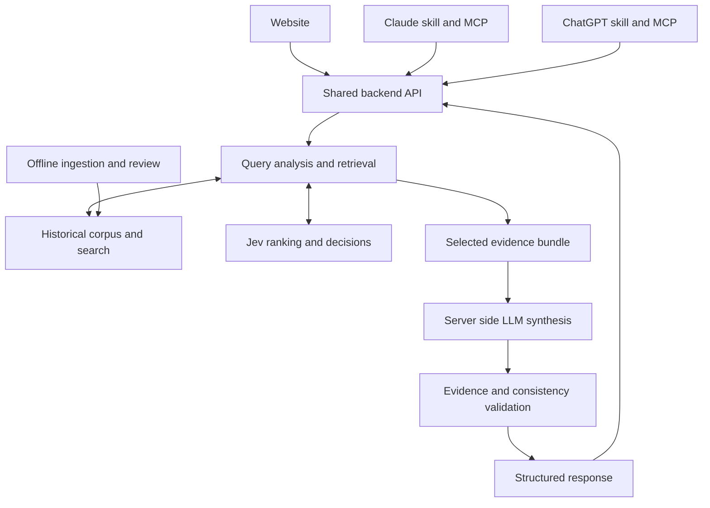

# Historical Figure System Design

OxHack 2026 · 24 October 2026 · Proposed architecture for 以古为鉴

Historical Figure helps people reason about a present decision through sourced historical cases. Its core output is a comparison of decision patterns, the limits of each comparison, and practical actions. This document covers a hackathon MVP and the path to a larger service. All performance targets and sizing figures below are planning assumptions, not measurements.

## 1 Functional requirements

| ID | Requirement | MVP acceptance condition |
| --- | --- | --- |
| F1 | Accept a present-day dilemma in natural language | A user describes a situation, decision, and optional constraints in English or Chinese. |
| F2 | Identify the decision structure | Extract options, actors, incentives, stakes, time horizon, information gaps, reversibility, and whether relationships repeat. Keep unknown values explicit. |
| F3 | Ask a targeted clarification when needed | Ask at most two questions when an unknown could materially change the recommendation. Otherwise proceed with stated assumptions. |
| F4 | Retrieve historical decision cases | Find cases through semantic similarity, keywords, and decision-pattern tags. A relevant decision moment is the retrieval unit. |
| F5 | Use Jev to evaluate relevance | Return a rubric-based relevance rating, component scores, and the underlying Jev uncertainty information. |
| F6 | Return historical context with evidence | Each displayed historical claim links to stored supporting passages and source metadata. |
| F7 | Explain the analogy | State shared mechanisms, important differences, and the circumstances in which the analogy stops applying. |
| F8 | Provide practical advice | Return a short recommendation, two or three next steps, and a condition that would change the recommendation. Label advice as interpretation. |
| F9 | Seek a counterexample | Search for a relevant case that challenges the initial lesson. Include it when sufficiently relevant; never manufacture opposition. |
| F10 | Handle conflicting claims and recommendations | Preserve disputed historical accounts and express conflicting recommendations as conditional alternatives where appropriate. |
| F11 | Support multiple clients | Expose a shared backend for a website and assistant integrations. Deliver the website and one assistant integration during the hackathon. |
| F12 | Support follow-up changes | Re-run retrieval and ranking when the user changes a decision-relevant fact. |
| F13 | Admit insufficient evidence | Return a clarification, weak-match warning, or no-match result instead of forcing a historical comparison. |
| F14 | Capture lightweight feedback | Record whether an analogy was helpful, misleading, or factually wrong. Saving the original dilemma is optional. |

The first release should cover a narrow, reviewed collection: approximately 20–30 decision cases across four themes such as negotiation, leadership, uncertainty, and commitment. If time becomes tight, prioritise 8–12 excellent cases. Comprehensive historical coverage is a long-term corpus-building objective; no database can establish that it contains all historical events.

Outside MVP scope: open-web crawling during each answer, autonomous decisions, training a foundation model, a historical knowledge graph, multiple debating agents, voice, and historical-person impersonation. Figure perspectives can be added later, but must be presented as modern interpretations rather than authentic statements from the person.

## 2 Non-functional requirements

| Area | Proposed target or rule | Verification |
| --- | --- | --- |
| Latency | At demo load, p95 evidence response under 3 seconds and complete validated answer under 12 seconds | Measure end-to-end timings on representative queries; include model time. |
| Capacity | Initially support 20 concurrent requests with bounded queues | Load-test the chosen deployment and provider quotas. |
| Availability | During the demo, return a useful result or explicit error; later service target 99.5% monthly availability | Track both transport errors and unusable answers. |
| Grounding | Every displayed historical factual claim has valid evidence references; failed semantic checks trigger repair or removal | Referential checks plus claim-level evaluation. A valid citation alone is insufficient. |
| Uncertainty | Keep analogy fit, model confidence, source quality, and outcome uncertainty separate | Schema and UI review. |
| Security | Model keys stay server-side; public endpoints have input limits and rate limits | Inspect deployed configuration and error responses. |
| Privacy | Default to no persistent raw dilemma or full chat storage; redact personal details before external model calls where feasible | Check telemetry and database writes. Disclose model-provider processing. |
| Consistency | Cite a single corpus version per response and record model/rubric versions | Replay requests against pinned versions. |
| Cost | Enforce configurable per-request token and call budgets; a tentative all-model target is under $0.10 per ordinary answer | Measure actual billed usage before presenting a cost claim. |
| Maintainability | One backend deployment, one database, and small provider adapters | Another teammate can run the service from documented environment variables. |
| Accessibility | Website supports keyboard navigation, legible evidence cards, and mobile layout | Manual interaction checks. |

These targets require benchmarking with your actual keys and hosting setup. Jev's speed does not remove network, retrieval, synthesis, or validation latency.

## 3 High-level design

### 3.1 Component responsibilities

The durable historical corpus lives in a database. Jev is a decision model: it evaluates supplied state using typed questions and returns structured answers. It is not the historical datastore or a natural-language writer. The application retrieves candidate records, asks Jev to judge them, and joins those scores back to their stored context. [1]

| Component | Responsibility |
| --- | --- |
| Website | Collect the dilemma and render advice, historical comparisons, and evidence. |
| Assistant skill | Describe when to use Historical Figure, which tool to call, and how to present the result. |
| MCP adapter | Expose the shared backend as assistant-callable tools with schemas and authentication. |
| Backend orchestrator | Validate input, manage deadlines, call retrieval and models, select evidence, and assemble the response. |
| PostgreSQL and pgvector | Store cases, source passages, metadata, and embeddings; run lexical and semantic retrieval. |
| Jev adapter | Route decisions, score candidate analogies, and optionally classify claim-support relationships. |
| Server-side LLM | Extract free-form context where needed and write the comparison and advice. |
| Validator | Check output shape, evidence references, support, and incompatible recommendations before release. |
| Offline ingestion job | Create and review source-backed cases, embeddings, and corpus versions. |

The website calls your backend; your backend calls the LLM. Do not put provider secrets or the trusted synthesis workflow in browser code.



These boxes are logical modules. They do not require separate services. A modular monolith is the right starting point for a small hackathon team.

### 3.2 Online request flow

1. Validate request size, authenticate the client where applicable, assign a request ID, and establish an overall deadline.
2. Separate user-provided facts from interpretations. Extract a compact decision profile and mark missing information.
3. Return a targeted clarification if an important missing fact prevents a useful comparison.
4. Search historical cases using the original query and a decision-structure representation.
5. Ask Jev to score the shortlisted cases against a fixed rubric using their pre-decision context.
6. Select a small set of distinct, sufficiently relevant cases. Seek a challenging case through an explicit counterexample pass.
7. Fetch the exact approved source passages and outcome records for the selected cases.
8. Ask the LLM to write a structured comparison and conditional advice using that evidence bundle.
9. Validate schema, evidence references, factual support, and recommendation consistency. Allow at most one repair attempt.
10. Return the validated answer, a reduced answer containing only verified material, or an explicit failure state.

For a tiny corpus, score all reviewed cases rather than building a complex candidate-search layer. Keep the retrieval interface so larger search can replace that implementation later.

### 3.3 Offline ingestion flow

Approved source → extract passages → create decision-case draft → review claims and chronology → annotate decision patterns → compute embeddings → publish a versioned corpus.

User queries never depend on an ingestion job completing. New drafts remain unavailable to public retrieval until approved.

## 4 Historical data and knowledge representation

### 4.1 Store decision moments

An event can contain many decisions. A biography or a whole war is too broad to be a useful analogy unit. Each case should describe what an actor knew, wanted, and could choose at a particular moment.

Separate three layers:

1. Historical observations: sourced statements about what happened.
2. Historical interpretation: an attributed account of why it happened, including disputed explanations.
3. Modern application: the system's inference about the user's situation.

An interpretation should not silently become a fact during summarisation.

### 4.2 Core schema

| Entity | Essential fields |
| --- | --- |
| Source | `source_id`, title, author/institution, URL, publication date if known, retrieval time, rights metadata, content hash |
| Passage | `passage_id`, `source_id`, exact text, page/section/paragraph locator, content hash |
| Event | `event_id`, title, date range, date precision, geography, participants |
| DecisionCase | `case_id`, `event_id`, `context_before`, actors, goals, available information, constraints, options, chosen action, outcome, outcome uncertainty, review status, version |
| Claim | `claim_id`, `case_id`, statement, type, support status, supporting passage IDs, contradicting passage IDs |
| MechanismAnnotation | `case_id`, mechanism tags, incentives, reversibility, repeated/one-shot relationship, horizon, annotation provenance |
| CaseEmbedding | `case_id`, representation type, vector, embedding model/version, case version |
| RequestTrace | request ID, stage timings, selected case/version IDs, rubric/model versions, status, token usage; no raw dilemma by default |
| Feedback | request ID, helpfulness or issue type, optional comment, consent/retention information |

For MVP, `DecisionCase` can use JSONB for options and annotations. Use relational tables for sources and passages, because evidence needs stable identity. Avoid a giant single text document that loses source-to-claim links.

Historical dates need uncertain ranges and era-aware display. Do not fabricate an exact day for an event whose date is disputed. Store approximate years separately from a precise modern timestamp.

### 4.3 The case card

Each case should answer:

- What decision was being made?
- What information was available at that time?
- What incentives and power relationships shaped the decision?
- What alternatives were feasible?
- What action was taken and what happened afterwards?
- Which parts of the causal explanation are disputed?
- Which conditions make this case a useful or misleading analogy?
- Which passages support those statements?

Useful mechanism tags include credible commitment, escalation, information asymmetry, coalition building, principal–agent conflict, irreversible investment, resource triage, and short-term versus long-term incentives. Tags aid retrieval; they do not prove that a mechanism caused the outcome.

### 4.4 Corpus quality

Prefer well-attributed material from archives, museums, academic publications, and documented primary records. Primary sources also have perspective and bias. Store disagreements rather than assuming that a primary source is automatically correct.

Record usage rights before retaining full source documents. Link to material and retain permitted excerpts when full reproduction is unavailable. A second independent source is desirable for central or disputed claims; several sites repeating the same account do not provide independent corroboration.

During the hackathon, manually verify every case you will demo. LLMs can draft cards, but unreviewed model output must not enter the approved corpus.

## 5 Understanding the user's decision

Represent the present situation as a structured profile:

```json
{
  "decision": "Whether to replace the working backend before tomorrow's demo",
  "options": ["keep and stabilise", "replace", "run an isolated experiment"],
  "actors": ["user", "teammate"],
  "constraints": ["one day remaining", "current implementation partly works"],
  "time_horizon": "one day",
  "reversibility": "unknown",
  "relationship": "repeated",
  "known_facts": ["The demo is tomorrow"],
  "unknowns": ["Is there a tested rollback path?"],
  "assumptions": []
}
```

Free-form extraction belongs to a text-generating model, or to the assistant host when that is appropriate. Jev can classify predefined dimensions using Choice or evaluate individual labels using Noul. Do not assume it can generate an arbitrary narrative profile. Choice returns one option, so multi-label mechanism tagging needs multiple questions or a separate extraction step. [2][3]

Validate the profile against the user's text. For example, “my teammate is being stubborn” is the user's interpretation; it does not establish the teammate's motive. Preserve that distinction when building the comparison.

Keep the MVP extraction small. The original query plus a few explicit constraints can be sufficient; avoid a long chain of models before retrieval.

## 6 Retrieval and Jev ranking

### 6.1 Candidate generation

Maintain two useful search representations per case:

- A concise pre-decision situation, stripped of unnecessary names and outcome details.
- A mechanism description, such as an irreversible commitment under uncertain information and time pressure.

Run semantic and lexical retrieval in parallel and merge their ranked lists. At larger corpus sizes, retrieve around 50 from each route, deduplicate, and send approximately 12–24 candidate cards to Jev. These are initial tuning values. Postgres full-text search and pgvector can support this hybrid approach; reciprocal rank fusion avoids treating lexical scores and vector distances as if they shared a numeric scale. [4]

Do not require a historical case to belong to the same surface domain as the user. A laboratory decision may share incentives with a diplomatic case. Explicitly evaluate the institutional and moral differences before applying the lesson.

### 6.2 Score the structure before reading the outcome

Initially rank cases using `context_before`, incentives, constraints, and options. Hide outcome fields during this step. Otherwise the system may search for a historical success that conveniently justifies advice it already wants to give.

This separation reduces one pathway for hindsight bias; it does not eliminate bias in the underlying corpus or pretrained models. Fetch the outcomes only after structural selection.

Use four Jev Score questions per candidate:

| Dimension | Question |
| --- | --- |
| Structural fit | Do the options and underlying decision mechanism resemble the present dilemma? |
| Incentive fit | Are the incentives, power relationships, and cooperation/conflict patterns comparable? |
| Constraint fit | Are the resources, information, and reversibility sufficiently similar? |
| Time fit | Are urgency, feedback speed, and decision horizon comparable? |

Use a five-level rubric from 0 to 4. Give each dimension its own precise level descriptions. For structural fit, the levels can run from unrelated, to superficial overlap, to partial mechanism overlap, to strong mechanism overlap, to a close match with only minor structural differences.

Jev's Score primitive uses an ordered `criteria` array and returns a score along that scale, together with level probabilities and confidence. Preserve those fields rather than treating the score as an exact measurement. [5]

### 6.3 Relevance number

Normalise the four scores to 0–1 and start with:

`analogy_fit = round(100 × (0.45 × structural + 0.25 × incentives + 0.20 × constraints + 0.10 × time))`

These weights are an application heuristic to evaluate and tune. They are not supplied or validated by Jev.

Apply independent eligibility gates for approved evidence and critical mismatches. A high similarity score must not compensate for an unsupported source or a fundamentally incompatible decision structure. Unknown user constraints should produce uncertainty or a clarification rather than an invented match.

Display `Analogy fit: 82/100` only as a rubric rating. Separately expose:

- Per-dimension Jev confidence and distributions.
- Source review status and disputes.
- Specific differences between the cases.
- Missing user information.

The number is not an 82% chance that the user will succeed. Jev's confidence about a classification is also not a probability that a historical account is true or that advice will work.

### 6.4 Jev API integration

The current documented endpoint is `POST https://api.typesafe.ai/v1/systemone`, authenticated with a bearer key. Send `state`, `model`, and a named map of `questions`. [6]

Illustrative request using placeholder case text, not an actual historical record:

```json
{
  "model": "jev-1.14.0",
  "state": {
    "user_decision": "Choose between stabilising a working system and an irreversible replacement under a short deadline",
    "candidate": {
      "case_id": "CASE_001",
      "context_before": "Insert the reviewed pre-decision context here",
      "constraints": ["Insert documented constraints here"],
      "options": ["Insert documented alternatives here"]
    }
  },
  "questions": {
    "structural_fit": {
      "type": "score",
      "instructions": "Rate how closely the underlying decision structure matches. Judge only the supplied pre-decision information.",
      "criteria": [
        "No relevant decision mechanism in common",
        "Surface similarity only",
        "Some shared mechanism with major differences",
        "Strong shared mechanism with important limits",
        "Close structural match with minor differences"
      ]
    }
  }
}
```

Pin a supported model version for reproducible evaluation. The reviewed model documentation currently lists `jev-1.14.0` and `jev-1.13.0`, with 64k per-request and 32k per-question context limits. Keep ordinary ranking batches comfortably below these limits; do not send the whole corpus. Recheck current account quotas before the demo. [7]

When batching cases, the question instructions must explicitly identify the case being evaluated. A question-map key such as `CASE_001_fit` is an application identifier, not a substitute for identifying the relevant case inside the question. Split batches by token budget and constrain concurrent calls.

### 6.5 Selection and counterexamples

Select up to three cases that balance relevance and diversity. Prevent three near-duplicate episodes from consuming the entire answer. Diversity can consider event cluster, mechanism, institutional setting, and perspective; geographic variety alone is insufficient.

After forming a tentative lesson, search for a case that challenges it under similar conditions. Retain the same relevance and evidence gates. Prefer a genuinely comparable failure or alternate outcome to an unrelated story with an opposite moral. If no credible counterexample exists in the collection, say so.

## 7 Advice generation and clash handling

### 7.1 The LLM's job

The backend gives the writer:

- User facts, unknowns, and explicitly marked assumptions.
- Selected case records and Jev scores.
- Approved claims, outcomes, and exact supporting passages.
- Contradictory accounts and known analogy limits.
- A fixed structured-output schema.

The writer returns a short recommendation, historical comparisons, actionable next steps, and a condition that would change the advice. It may explain or infer; it must not invent historical facts or quotations. Any direct historical quote must come from stored source text.

### 7.2 Three kinds of clash

| Clash | Example | Handling |
| --- | --- | --- |
| Sources disagree | Two accounts attribute a decision to different motives | Preserve the disagreement and attribution. Do not manufacture a consensus. |
| Historical lessons differ | One comparable case favours waiting and another favours acting | Explain the variables that distinguish them, such as reversibility or the cost of delay. |
| Recommendations contradict | The answer says both commit now and avoid commitment under the same conditions | Repair or remove the incompatible instruction before release. |

The useful result is conditional reasoning: “If a rollback is tested and the trial can be isolated, experiment; if it endangers the only working system, stabilise first.” That is more informative than forcing every historical case to agree.

### 7.3 Structured answer contract

```json
{
  "status": "ready",
  "decision_summary": "A short description of the present choice",
  "recommendation": {
    "text": "A practical recommendation",
    "kind": "modern_inference",
    "conditions": ["The conditions under which it applies"],
    "evidence_refs": ["CLAIM_001"]
  },
  "analogies": [
    {
      "case_id": "CASE_001",
      "analogy_fit": 82,
      "role": "supporting",
      "shared_mechanism": "A sourced comparison",
      "important_differences": ["A material limit"],
      "claim_refs": ["CLAIM_001"]
    }
  ],
  "next_steps": ["A concrete action"],
  "what_would_change_the_advice": ["A decision-relevant new fact"],
  "uncertainties": ["An unresolved issue"]
}
```

This is an abbreviated application schema; all example values are illustrative. The actual API also returns the approved claim and source objects referenced by these IDs. The backend computes authoritative scores and attaches evidence metadata; the writer does not get to overwrite them.

### 7.4 Validation

Run deterministic checks for schema, field lengths, permitted case/claim/passage IDs, score ranges, exact quotes, and source-version membership. Resolve URLs from stored metadata rather than accepting invented writer URLs.

Then assess semantic support for each historical claim using its cited passage. A Jev Choice question can classify it as `supported`, `contradicted`, or `insufficient_evidence`; this is an additional model judgement, not a truth oracle. Flag unconditional action conflicts and recommendations that ignore stated constraints. A second LLM is an optional later evaluator, rather than a mandatory expensive agent chain.

Allow one bounded repair using the actual validation errors. If it fails, remove unsupported claims and their dependent recommendations. Return only useful verified content, or an explicit insufficient-evidence result when nothing adequate remains.

Do not stream unverified advice as if it were final. Stream progress messages or already approved evidence cards, then release the complete validated answer. Model checking reduces risk but cannot guarantee that every error or contradiction is detected.

## 8 API design and client integrations

### 8.1 Shared HTTP API

| Endpoint | Purpose |
| --- | --- |
| `POST /v1/advice` | Full pipeline; return a canonical answer, evidence, scores, and validation status. |
| `POST /v1/evidence` | Optional evidence-only route for hosts that intentionally perform their own synthesis. |
| `GET /v1/cases/{case_id}` | Retrieve an approved public case and supporting sources. |
| `POST /v1/feedback` | Submit helpfulness or issue feedback. |
| `GET /health` | Check service health without exposing secrets. |

Example advice request:

```json
{
  "query": "My teammate wants to rebuild our backend one day before the demo. Should I agree?",
  "language": "en",
  "max_cases": 3,
  "constraints": {
    "deadline_hours": 24,
    "rollback_tested": false
  }
}
```

Return a `request_id`, `corpus_version`, `rubric_version`, model versions, status, answer, selected evidence, and warnings. Use explicit statuses: `ready`, `needs_clarification`, `insufficient_evidence`, and `partial`. Input failures and dependency outages need structured error codes; they must not look like completed advice.

Use a short-lived anonymous session or a signed optional client token for the website. A public demo can remain login-free while using strict rate limits. Assistant clients use a server-side integration credential for a shared public corpus; add user authorisation before introducing saved private decisions. Never ship the shared credential in website JavaScript.

### 8.2 MCP tools

Expose thin wrappers over the same service functions:

| Tool | Input | Output |
| --- | --- | --- |
| `get_historical_advice` | Dilemma, language, optional constraints | Canonical validated answer plus evidence. |
| `get_historical_case` | Approved case ID | Case details and sources. |

The two lookup tools are read-only. Keep feedback submission separate because it writes data. Enforce input bounds and authentication in the backend, independent of whether the calling assistant follows its instructions.

### 8.3 Claude skill

Package concise instructions in `SKILL.md`: recognise a decision-advice request, ask a material clarification if needed, call `get_historical_advice`, preserve sources and uncertainties, and avoid inventing quotes or historical facts. Claude Code documents this instruction-based skill format; test the selected Claude surface's available skill and MCP capabilities before the demo. [8]

The skill supplies the workflow; the connected tool supplies the actual corpus and model-backed service. A skill file alone cannot operate a remote historical backend.

### 8.4 ChatGPT skill or plugin

Use the same conceptual workflow and MCP tools, packaged for the ChatGPT environment you will demonstrate. OpenAI's current documentation describes skills as reusable instructions and resources, with MCP servers providing live data and tools inside plugins. Do not assume that a single unmodified installation manifest works on every assistant host. [9][10]

For consistent validation across clients, use the full advice tool and ask the host to present its canonical response and sources. If you deliberately expose evidence-only retrieval, the host becomes responsible for synthesis and may introduce new errors. Your server's validation applies to its returned answer, not arbitrary text that a host later adds or rewrites.

Do not spend the hackathon publishing into every marketplace. Demonstrate the website plus one working assistant connection; retain adapters for the next integration.

## 9 Deployment, reliability, and privacy

### 9.1 Initial deployment

Use a React or Next.js website, one Python FastAPI backend, and managed PostgreSQL with pgvector. The language choices are suggestions: if the team is faster in TypeScript, use one TypeScript backend rather than adding Python for its own sake. Run corpus ingestion as a local or one-off job initially. Add object storage only when retained source files justify it.

The backend owns retrieval, Jev calls, LLM calls, validation, and the MCP adapter. Use environment variables for secrets and provider model IDs. Keep an embedding adapter and a Jev adapter small enough to replace independently. Avoid a graph database, Kubernetes, Kafka, and a dedicated vector service for the MVP.

### 9.2 Failure modes

| Failure | Behaviour |
| --- | --- |
| Jev times out or is rate-limited | Use a bounded retry only if time remains. Otherwise return retrieved evidence with `ranking_status: unavailable`; do not invent Jev scores. |
| Writer is unavailable | Return approved historical case cards with `status: partial`; omit personalised advice. |
| Embedding provider is unavailable | Fall back to lexical retrieval over approved cases; disclose reduced retrieval quality. |
| Database is unavailable | Return a clear service error. Optionally support a versioned read-only snapshot of the approved demo corpus. |
| Validation fails | Attempt one repair, then remove failed material or return insufficient evidence. |
| No sufficiently relevant case | Ask a targeted question or state the corpus has no strong match. |
| Stored source URL is unavailable | Use a permitted stored passage and disclose its retrieval date; do not claim the URL was checked live. |

Use one end-to-end deadline, small per-stage budgets, bounded concurrency, and at most one dependency retry with backoff when safe. Never nest independent retry loops that exceed the user's latency budget. Cancel downstream work on client disconnect where practical.

### 9.3 Caching

Cache public case records and embeddings by content version. Cache reranking only with a key containing the sanitised decision profile, candidate case versions, Jev model, rubric, and relevant constraints. Avoid cross-user response caching for private dilemmas. A hash alone does not anonymise a guessable query.

Changing “there is no rollback” to “the rollback is tested” must invalidate the relevant ranking/advice cache. Corpus updates should generate a new corpus version and invalidate dependent entries. Feedback does not silently edit historical facts.

### 9.4 Security and privacy

Treat user text and retrieved passages as untrusted data, never executable instructions. The writer does not need arbitrary network, shell, SQL, or action tools. Keep passage text in bounded evidence fields. Ingestion fetchers should use approved source domains and defend against private-network fetches and oversized documents.

Redact unnecessary names and contact details before provider calls. Send only the current dilemma and relevant context rather than an entire chat history. Tell users which external model services process their text and provide a clear retention policy. Do not promise deletion from external providers unless their actual configuration supports it.

Keep ingestion/admin operations separate from public lookup endpoints. Logs should record stage times, provider errors, IDs, and versions rather than sensitive raw prompts by default. If saved decision journals are introduced later, add per-user access control, consent, deletion, and tenant-scoped retrieval/caching.

## 10 Capacity and cost planning

### 10.1 Corpus scale

For approximately 20–30 cases, exact retrieval is sufficient and all-case Jev scoring may be practical. At thousands of cases, hybrid candidate retrieval avoids comparing every case for every query. At much larger scale, add vector indexes, partitioning where useful, asynchronous ingestion, and dedicated retrieval workers based on measured bottlenecks.

Illustrative sizing: one 1,536-dimensional float32 vector uses about 6.1 kB before database overhead. Two vectors per case across one million cases use approximately 12.3 GB before indexes, text, metadata, and replicas. This assumes that embedding size; it is not a required model choice. Source documents and evidence passages can dominate storage.

### 10.2 Model cost

Compute total answer cost from actual provider usage:

`cost = embedding cost + Jev billed input cost + LLM input/output cost + validation cost`

The reviewed Jev model page lists $0.042 per million input tokens and free output tokens. At that rate, 10,000 billed input tokens cost $0.00042. This arithmetic covers only that Jev usage, not the full request or hosting. Recheck pricing before a public claim. [7]

Track dollars and tokens per stage. The main controllable limits are candidate count, passage length, output length, and repair count. Do not assume that adding more model passes is free simply because one component is inexpensive.

## 11 Evaluation and acceptance

### 11.1 Build a small evaluation set

Prepare around 30 dilemmas, spanning good matches, misleading surface similarities, insufficient context, weak corpus coverage, and adversarial instructions. Separately test a few independent historical claim sets. Label each dilemma with acceptable mechanism matches, important mismatches, and conditions that should change advice. There can be several valid historical comparisons.

Use a development subset to tune weights and rubrics, then hold back a smaller subset for a final check. Do not report tuning-set performance as generalisation.

### 11.2 Evaluate each stage

| Stage | Measure |
| --- | --- |
| Candidate retrieval | Whether acceptable decision cases appear in the candidate set. |
| Jev ranking | Agreement with human ordinal relevance judgements; ranking quality against labelled alternatives. |
| Uncertainty | Whether low-certainty results are surfaced; assess task-specific calibration before giving confidence a probabilistic interpretation. |
| Evidence | Human-checked claim support, source attribution, and exact-quote accuracy. |
| Advice | Relevance, feasibility, conditionality, and whether stated user constraints are respected. |
| Clash handling | Whether conflicting accounts and incompatible unconditional actions are recognised. |
| Operations | p50/p95 latency, cost, timeout frequency, and partial/no-match rates. |

Critical adversarial checks: a request to invent a quotation; an unrelated case with matching keywords; a passage containing “ignore previous instructions”; a changed rollback constraint; a missing source reference; and a provider outage.

### 11.3 Prove Jev's contribution

Compare the same queries and candidate pool across three configurations:

1. Retrieval alone, followed by the writer.
2. Retrieval plus Jev ranking, followed by the same writer.
3. Retrieval plus Jev ranking and the counterexample pass, followed by the same writer.

Hold the corpus and prompts constant where possible. Judge whether Jev improves structural relevance and whether the challenging case changes useful advice. Measure latency and cost as well as answer preference. Do not claim an improvement until the comparison supports it.

Demo acceptance: the full path works from a fresh query; every displayed historical fact has checked evidence; changing a material constraint triggers a recomputation; weak matches are disclosed; and at least one simulated provider failure gives an honest fallback.

## 12 Twenty-four-hour delivery plan

| Time | Deliverable | Suggested owner |
| --- | --- | --- |
| Hours 0–2 | Agree on decision themes, API contract, corpus schema, Jev access, and one live provider call | Whole team |
| Hours 2–6 | Curate the initial case set and evidence; implement database and a minimal end-to-end vertical slice | Data/backend owner; support from all |
| Hours 6–10 | Implement candidate lookup, Jev rubric scoring, and evidence joining | Backend owner |
| Hours 6–12 | Build dilemma input, comparison cards, source drawer, and progress/error states | Frontend owner |
| Hours 10–15 | Add structured advice generation and deterministic evidence validation | Backend/LLM owner |
| Hours 15–18 | Add the counterexample pass, bounded repair, and one assistant integration | Split by current bottleneck |
| Hours 18–21 | Evaluate fresh queries, constraint changes, and outage cases; reduce scope if needed | Whole team |
| Hours 21–24 | Deploy, rehearse, verify sources, and fix visible failures | Whole team |

For two people, combine corpus curation and frontend work, and let the other person own the backend/model path. Everyone should review the cases used in the demo. If time is short, remove secondary integrations and optional model checks before sacrificing evidence quality or the working vertical slice.

## 13 Demo story

Open with a dilemma the judges understand: “We have one day left at a hackathon. My teammate wants to replace a backend that already partly works. Should we?”

Show the extracted constraints, then relevant historical decision cards with sourced context. NASA's Apollo 13 account documents rationing power and shutting down noncritical systems; it could support an explicitly labelled inference about preserving essential capabilities under resource pressure. NASA's Apollo 11 summary describes continuing through computer alarms after Mission Control's assessment; it can challenge a simplistic rule that every warning means stopping. These two episodes are candidate case material, not evidence that a particular hackathon decision will succeed. Their professional expertise and mission conditions differ sharply from a student project. [11][12]

Demonstrate the actual mechanism: change “no rollback and unknown implementation risk” to “tested rollback and an isolated experiment.” The system should recompute the profile and scores, then explain whether and why its recommendation changes. If it does not change, explain the remaining constraint rather than forcing a theatrical reversal.

Finish by asking a fresh question in the assistant integration and opening an original source. The distinctive product claim is that the system makes historical comparisons inspectable: what is shared, what differs, and which new fact would change the advice.

## 14 Design decisions to keep

| Decision | Reason |
| --- | --- |
| Database stores history | Durable, versioned, attributable records can be inspected and corrected. |
| Retrieval precedes Jev | The corpus can grow without placing all history in every model request. |
| Jev judges typed dimensions | Its role is measurable ranking and routing with explicit uncertainty. |
| The LLM writes server-side | One trusted synthesis path serves every client and keeps secrets out of the browser. |
| Evidence and recommendation are separate | A sourced event does not prove that a modern action will work. |
| Counterexamples have relevance gates | Opposition should challenge reasoning rather than decorate the answer. |
| Skills wrap shared tools | Website and assistant clients can reuse the same corpus and validation logic. |
| Begin with a modular monolith | The hackathon team can ship and debug one coherent system. |

## References

Official technical documentation was reviewed on 24 October 2026. Proposed scoring weights, architecture, targets, and delivery estimates are design recommendations, not vendor guarantees.

1. [TypeSafe introduction](https://docs.typesafe.ai/introduction)
2. [TypeSafe Choice](https://docs.typesafe.ai/primitives/choice)
3. [TypeSafe Noul](https://docs.typesafe.ai/primitives/noul)
4. [pgvector official repository and hybrid search guidance](https://github.com/pgvector/pgvector)
5. [TypeSafe Score](https://docs.typesafe.ai/primitives/score)
6. [TypeSafe System One API](https://docs.typesafe.ai/api/system-one)
7. [TypeSafe model versions, limits, and pricing](https://docs.typesafe.ai/models)
8. [Claude Code skills](https://code.claude.com/docs/en/skills)
9. [OpenAI skills and MCP responsibilities](https://developers.openai.com/plugins/concepts/skills)
10. [ChatGPT MCP integration](https://learn.chatgpt.com/docs/extend/mcp)
11. [NASA Apollo 13 mission details](https://www.nasa.gov/missions/apollo/apollo-13-mission-details/)
12. [NASA Apollo 11 mission summary](https://www.nasa.gov/wp-content/uploads/static/history/alsj/a11/a11.summary.html)
